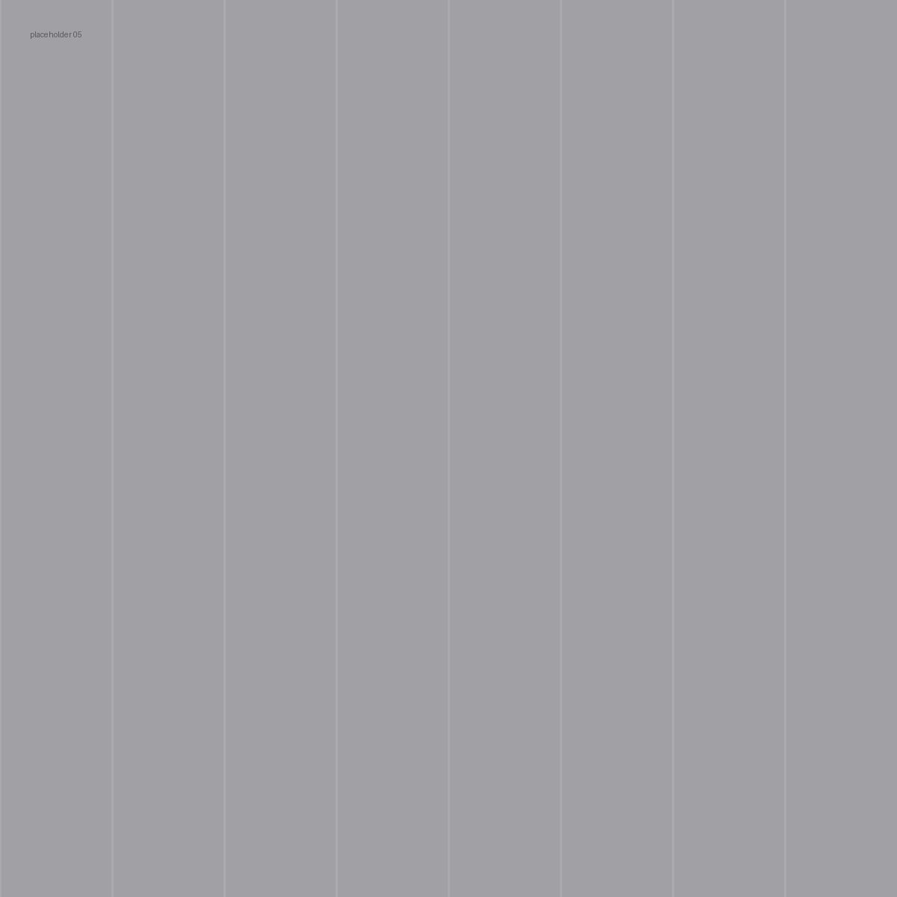
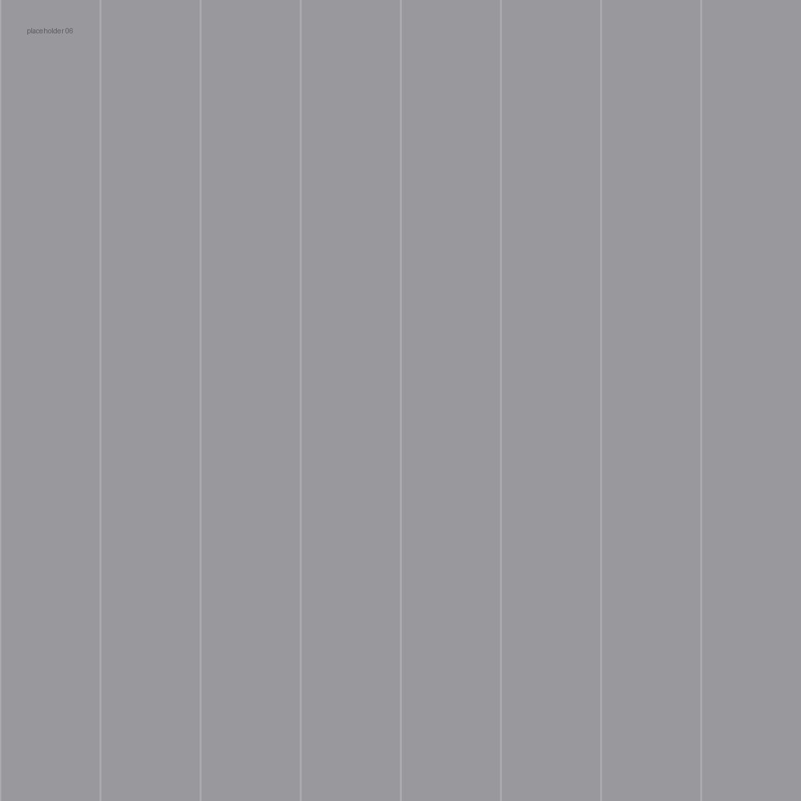

Buildings and cities I have photographed while travelling, often for conferences and research stays.

<!--
HOW TO ADD PHOTOS
1. Put the files in the photos/ folder (JPG, long edge ~2000 px, so the page loads fast).
2. Copy one line per photo below: file name + short caption (place, city, year).
3. Clicking a photo opens it full screen (lightbox).
Choose 9–15 of your best shots rather than everything; the grid has 3 columns.
-->

::: {.photo-grid}
{group="arch"}

{group="arch"}

{group="arch"}

{group="arch"}

{group="arch"}

{group="arch"}
:::
